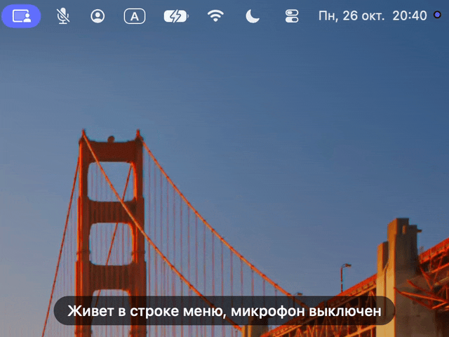

# 🎙️ PushToTalk

🇬🇧 [English](README.md) | 🇷🇺 Русский

> Приложение для строки меню macOS: микрофон включен, только пока зажата горячая клавиша

## 📖 Описание

PushToTalk выключает микрофон и включает его на время, пока вы держите горячую клавишу. Работает глобально, во всех приложениях, которые записывают звук с управляемого устройства ввода (Google Meet, Zoom, Teams, Discord и другие): приложение переключает mute у самого устройства, а не у отдельной программы.



Это форк [yulrizka/osx-push-to-talk](https://github.com/yulrizka/osx-push-to-talk) с нативной сборкой под Apple Silicon. Сборка универсальная (arm64 + x86_64), Rosetta ей не нужна. Это важно, потому что с macOS 28 Rosetta останется только для отдельных старых игр, и программы только для Intel там не запустятся ([Apple](https://support.apple.com/en-us/102527)). Оригинал не собирается в Xcode 27: Xcode не принимает его deployment target 10.14. Часть функций взята из форков и открытых pull request'ов оригинала, список в разделе "Связанные проекты".

Что умеет приложение:

- Горячая клавиша (по умолчанию правый ⌥) включает микрофон, пока зажата, и выключает при отпускании.
- Двойное нажатие оставляет микрофон включенным, следующее двойное нажатие выключает его. Одиночные нажатия работают как обычно и не снимают фиксацию.
- Пока зажаты другие модификаторы, клавиша игнорируется, поэтому сочетания вроде ⌘⌥ микрофон не включают.
- Пока микрофон выключен, mute применяется заново каждые 0,2 секунды (sticky mute): если другая программа сбросит устройство ввода, mute вернется.
- Приложение управляет устройством ввода по умолчанию или тем, которое вы закрепили в меню. Выбор запоминается, список устройств обновляется при подключении и отключении.
- В меню видна громкость ввода (чувствительность) управляемого устройства: ползунок меняет ее, а замок возвращает запомненное значение, если его изменит другое приложение.
- Иконка в строке меню показывает состояние: выключен, включен, приложение отключено или ждет новую клавишу.
- Каждое изменение сопровождается звуком: Pop при включении микрофона, Tink при выключении. После короткого нажатия звук выключения ждет окно двойного нажатия, поэтому двойное нажатие дает один звук. У каждого звука свой уровень в меню (0% выключает его).

## 🔧 Технологический стек

| Слой      | Технология                                         |
|-----------|----------------------------------------------------|
| Язык      | Swift 6                                            |
| Интерфейс | AppKit, приложение в строке меню                   |
| Аудио     | CoreAudio: mute и громкость ввода устройства       |
| Сборка    | Xcode 26+, универсальный бинарник (arm64 + x86_64) |

## 🚀 Быстрый старт

### Требования

1. macOS 14 или новее, чтобы запускать приложение.
2. Xcode 26 или новее, чтобы собирать его из исходников.
3. Сторонних зависимостей нет.

### Готовая сборка

1. Откройте последний запуск workflow [Build](https://github.com/BrainRTP/osx-push-to-talk/actions/workflows/Build.yaml) и скачайте артефакт `PushToTalk.app`.
2. Распакуйте архив и перенесите `PushToTalk.app` в `/Applications`.
3. Приложение подписано ad hoc и не нотаризовано, поэтому macOS не откроет скачанную копию. Снимите флаг карантина командой ниже или разрешите запуск: Системные настройки > Конфиденциальность и безопасность > Все равно открыть.

```bash
# Снять флаг карантина со скачанной копии
xattr -dr com.apple.quarantine /Applications/PushToTalk.app
```

### Сборка из исходников

```bash
git clone https://github.com/BrainRTP/osx-push-to-talk.git
cd osx-push-to-talk

# Release-сборка, результат: build/Release/PushToTalk.app
xcodebuild -project PushToTalk.xcodeproj -target PushToTalk -configuration Release

# Установка (ditto, а не cp -R: cp положит новый бандл внутрь уже установленного)
rm -rf /Applications/PushToTalk.app && ditto build/Release/PushToTalk.app /Applications/PushToTalk.app
```

У собранной локально копии флага карантина нет, снимать его не нужно.

### Homebrew

У форка своего tap нет. Tap оригинала (`brew install yulrizka/tap/pushtotalk`) собирает исходную версию 0.1.5: изменений форка в ней нет, а в Xcode 27 она не собирается, потому что его минимальный deployment target macOS 12.

### Запуск и удаление

Запустите `PushToTalk.app`: в строке меню появится иконка. Чтобы удалить приложение, выйдите из него (это снимет mute) и удалите `PushToTalk.app` из `/Applications`. Настройки лежат в `~/Library/Preferences/com.yulrizka.PushToTalk.plist`.

## 🎛️ Использование

После запуска в строке меню появляется иконка, микрофон сразу выключен. Доступ к микрофону приложение не запрашивает: mute меняется через свойство устройства в CoreAudio.

### Горячая клавиша

- Новую клавишу задает пункт меню `Change HotKey`: выберите его и нажмите модификатор ⌥, ⌘, ⌃, ⇧ или fn, левый или правый. Обычные клавиши и Caps Lock не подходят.
- Окно двойного нажатия равно 0,3 секунды. Изменить его можно командой `defaults write com.yulrizka.PushToTalk prefDoubleTapInterval -float 0.35`, перезапуск не нужен.

### Иконка в строке меню

| Иконка                    | Состояние                                                                |
|---------------------------|--------------------------------------------------------------------------|
| 🔇 Перечеркнутый микрофон | Микрофон выключен                                                        |
| 🟢 Зеленый микрофон       | Микрофон включен: клавиша зажата или зафиксирована двойным нажатием      |
| ⚪ Серый микрофон         | Приложение отключено и микрофон включен, или у устройства ввода нет mute |
| ⌨️ Клавиатура             | Приложение ждет новую горячую клавишу                                    |

### Меню

| Пункт                                              | Что делает                                                                                       |
|----------------------------------------------------|--------------------------------------------------------------------------------------------------|
| `Input volume: N%` + ползунок                      | Громкость ввода (чувствительность) устройства, `n/a`, если у устройства нет регулятора громкости |
| `Lock input volume`                                | Возвращает громкость, если ее изменит другое приложение. Снимается при смене устройства          |
| `Sound when live (Pop)`, `Sound when muted (Tink)` | Громкость звуков включения и выключения, 0% выключает звук                                       |
| `Disable` / `Enable`                               | Перестает управлять микрофоном и оставляет его включенным / снова выключает его                  |
| `Devices`                                          | `System Default` или закрепленное устройство. Устройства без mute выбрать нельзя                 |
| `Refresh Devices`                                  | Обновляет список вручную, обычно он обновляется сам                                              |
| `Change HotKey (Right-⌥)`                          | Записывает новую клавишу, в скобках текущая                                                      |
| `Quit PushToTalk`                                  | Выход, mute снимается                                                                            |

### Выход и настройки

Выход из приложения, из системы или выключение Mac снимают mute. Настройки хранятся в `~/Library/Preferences/com.yulrizka.PushToTalk.plist`.

## 🧪 Тестирование

```bash
# Unit-тесты (XCTest)
xcodebuild test -project PushToTalk.xcodeproj -scheme PushToTalk -destination 'platform=macOS'
```

CI ([Build](https://github.com/BrainRTP/osx-push-to-talk/actions/workflows/Build.yaml)) собирает универсальное приложение, проверяет обе архитектуры и сохраняет `PushToTalk.app` как артефакт. Тесты CI не запускает.

Подобрать окно двойного нажатия помогает `tools/taptimer.swift`: он замеряет, как вы нажимаете горячую клавишу, и предлагает значение. Нажимайте клавишу как обычно, затем Ctrl-C, чтобы увидеть итог.

```bash
mkdir -p build && swiftc -O -o build/taptimer tools/taptimer.swift && build/taptimer
```

## 🩺 Траблшутинг

### Горячая клавиша ничего не делает

Слежение за модификаторами обычно не требует разрешений. Если приложение не реагирует, добавьте PushToTalk в Системные настройки > Конфиденциальность и безопасность > Мониторинг ввода (или Универсальный доступ) и перезапустите его. Если иконка серая, а в меню стоит пункт `Enable`, приложение отключено: включите его.

### "PushToTalk is damaged and can't be opened" или "unidentified developer"

Приложение подписано ad hoc и не нотаризовано. Снимите флаг карантина, как описано в разделе "Готовая сборка", или соберите приложение из исходников.

### Меня не слышно, хотя иконка зеленая

Посмотрите громкость ввода в меню и поднимите ее ползунком. Если она снова падает, включите `Lock input volume`: некоторые приложения сами снижают системный уровень входа.

### Иконка серая, в подсказке "The input device has no mute control"

У устройства ввода, которым пользуется macOS, нет управления mute, например у микрофона iPhone через Continuity. Другое устройство приложение само не выберет: заглушить микрофон, которым macOS не пользуется, значило бы оставить рабочий включенным. Переключите вход в Системные настройки > Звук > Вход на устройство с mute. Такие же иконка и подсказка бывают, когда устройств ввода нет совсем.

### Микрофон остался выключенным после того, как приложение убили

Выход из приложения снимает mute, а убитый процесс (например, через Force Quit) этого сделать не может. Запустите приложение и выйдите из него еще раз.

### Mute не применяется

Ошибки записи в CoreAudio (с кодом OSStatus) попадают в лог с подсистемой `com.yulrizka.PushToTalk`:

```bash
log stream --predicate 'subsystem == "com.yulrizka.PushToTalk"'
```

## 🔗 Связанные проекты

> Актуально на 26.10.2026. Из перечисленных форков взяты идеи функций.

| Проект                                                                               | Как связан                                                                                                                                                              |
|--------------------------------------------------------------------------------------|-------------------------------------------------------------------------------------------------------------------------------------------------------------------------|
| [yulrizka/osx-push-to-talk](https://github.com/yulrizka/osx-push-to-talk)            | Оригинал, форк начат с его версии 0.1.5. Автор Ahmy Yulrizka                                                                                                            |
| [yulrizka/osx-push-to-talk#44](https://github.com/yulrizka/osx-push-to-talk/pull/44) | Pull request с мониторингом состояния микрофона, в оригинал не влит. Идея обновлять устройства при подключении реализована заново, без вендорной библиотеки из этого PR |
| [12joan/push-to-talk](https://github.com/12joan/push-to-talk)                        | Идея повторно применять mute каждые 0,2 секунды                                                                                                                         |
| [gerotakke/osx-push-to-talk](https://github.com/gerotakke/osx-push-to-talk)          | Идея запоминать выбранное устройство ввода                                                                                                                              |
| [arx8x/osx-push-to-talk](https://github.com/arx8x/osx-push-to-talk)                  | Идея запоминать выбранное устройство ввода                                                                                                                              |
| [RoryQ/osx-push-to-talk](https://github.com/RoryQ/osx-push-to-talk)                  | Идея игнорировать горячую клавишу, когда зажаты другие модификаторы                                                                                                     |
| [darruda/osx-push-to-talk](https://github.com/darruda/osx-push-to-talk)              | Идея цветных иконок состояния                                                                                                                                           |
| [nielubowicz/osx-push-to-talk](https://github.com/nielubowicz/osx-push-to-talk)      | Идея цветных иконок состояния                                                                                                                                           |

## 🔗 Ссылки

- [Оригинальный репозиторий](https://github.com/yulrizka/osx-push-to-talk)
- [Этот форк](https://github.com/BrainRTP/osx-push-to-talk)
- [Workflow Build в GitHub Actions](https://github.com/BrainRTP/osx-push-to-talk/actions/workflows/Build.yaml)
- [Apple: Using Intel-based apps on a Mac with Apple silicon](https://support.apple.com/en-us/102527): Rosetta работает в macOS 27 и раньше, с macOS 28 только для отдельных старых игр
- [История версий](CHANGELOG.md)
- [Авторы и контрибьюторы](AUTHORS)
- [Лицензия MIT](LICENSE)
- Иконка приложения: [jeff](https://thenounproject.com/jeff955/) (CC)

## 👤 Maintainers

[@BrainRTP](https://github.com/BrainRTP) (Stanislav Panchenko), оригинальный автор: Ahmy Yulrizka ([@yulrizka](https://github.com/yulrizka))
